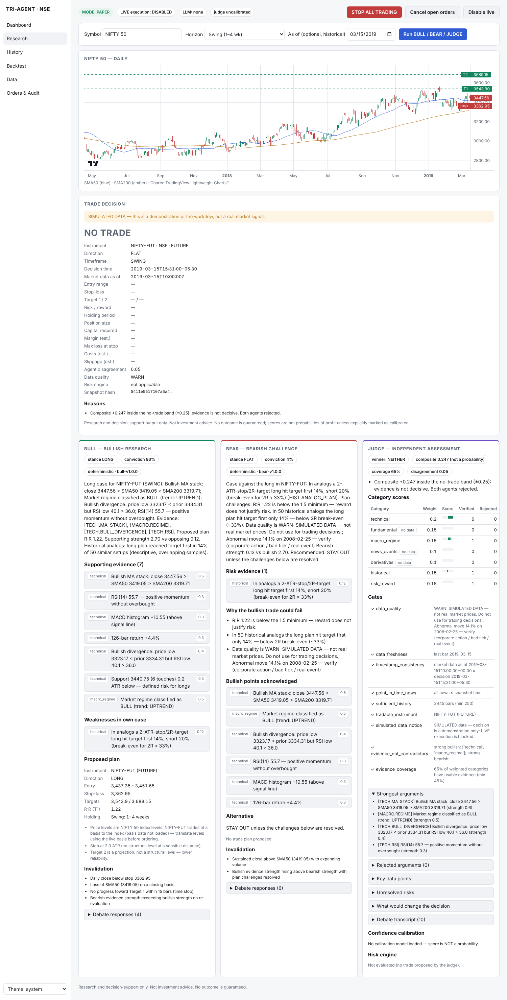

# Tri-Agent Indian Market Intelligence & Trading System

A research and decision-support platform for NSE / NIFTY 50. For each candidate trade, three agents work through
it in turn:

* **BULL** builds the evidence-based case for a long position.
* **BEAR** challenges it and proposes a short or STAY OUT, and must concede when the bullish case is stronger.
* **JUDGE** independently recomputes every claim and applies data and risk gates. It returns **BUY / LONG**,
  **SELL / SHORT** or **NO TRADE**, and prefers an honest NO TRADE over a weak signal.

> Not investment advice. No outcome is guaranteed. Paper trading is the default and **LIVE execution is
> disabled**: it needs three separate switches plus a human typing `CONFIRM TRADE` for every order.



## Quick start (Linux/macOS — Windows: see [docs/WINDOWS_SETUP.md](docs/WINDOWS_SETUP.md))

```bash
cd backend && python -m venv .venv && . .venv/bin/activate && pip install -r requirements.txt
```

```bash
python -m pytest -q
```

```bash
TRIAGENT_DEMO=true uvicorn triagent.api.main:app --port 8000
```

```bash
cd frontend && npm install && npm run dev
```

The dashboard is at http://localhost:5173 and the API docs at http://localhost:8000/docs.

`TRIAGENT_DEMO=true` loads a **SIMULATED** series, labelled everywhere. Load real data instead:

```bash
python -m triagent.cli ingest --source yahoo --symbol "NIFTY 50"
```

```bash
python -m triagent.cli ingest --source csv --path ../data/import/nifty50.csv --symbol "NIFTY 50"
```

Other commands:

```bash
python -m triagent.cli research --symbol "NIFTY 50" --horizon SWING
```

```bash
python -m triagent.cli report
```

```bash
python -m triagent.cli paper-demo
```

`report` writes the backtest, walk-forward and calibration report to `docs/reports/BACKTEST_REPORT.md`.
`paper-demo` walks one decision through ticket → CONFIRM → paper fill → audit.

### Docker (TimescaleDB + API + dashboard)

```bash
cp .env.example .env
```

Set `POSTGRES_PASSWORD` and `RISK_SIGNING_KEY` in `.env`, then:

```bash
docker compose up --build
```

The dashboard is at http://localhost:8080.

## Documentation

| | |
|---|---|
| [DEPLOYMENT](docs/DEPLOYMENT.md) | Cloudflare Pages + Access + Tunnel deployment, Windows backend setup |
| [ARCHITECTURE](docs/ARCHITECTURE.md) | design principles, decision flow, folder structure, scoring |
| [AGENTS](docs/AGENTS.md) | evidence rules, BULL/BEAR/JUDGE logic, debate, prompts |
| [DATA_SOURCES](docs/DATA_SOURCES.md) | source-by-source inventory, coverage, quality rules |
| [API](docs/API.md) | endpoints |
| [BROKER_COMPARISON](docs/BROKER_COMPARISON.md) | Indian broker APIs; adding a broker |
| [REGULATORY_CHECKLIST](docs/REGULATORY_CHECKLIST.md) | SEBI retail-algo framework, pre-live checklist |
| [SECURITY](docs/SECURITY.md) | secrets, tokens, exposure |
| [COSTS](docs/COSTS.md) | monthly operating cost estimate |
| [PHASE_REPORT](docs/PHASE_REPORT.md) | what is built, tested, incomplete; acceptance criteria |
| [reports/](docs/reports) | backtest/calibration report and paper-trading demo (SIMULATED data) |

## Configuration

* Weights, thresholds, risk limits and debate rounds: `config/settings.toml`. Override them in `config/local.toml`, which is git-ignored.
* NSE cost schedule (effective-dated STT, exchange, stamp, GST), lot sizes and expiry weekday: `config/costs_in_nse.toml`. **Verify these before relying on them.**
* Secrets: environment only (see `.env.example`).
